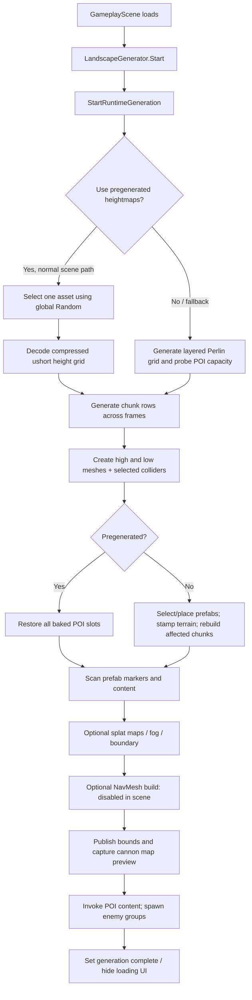
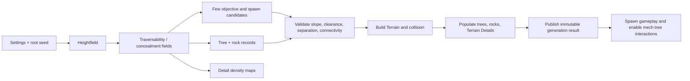

# Ritual Division Map Generation Audit for the Kartikaris Port

Audit date: 2026-08-05  
Repository: `Ritual Division`  
Unity version: `6000.3.9f1` (`ProjectSettings/ProjectVersion.txt`)  
Runtime render pipeline: URP 17.3.0 (`Packages/manifest.json`)  
Navigation package: AI Navigation 2.0.10 (`Packages/manifest.json`)

## Scope and evidence labels

This is a read-only architectural audit. No existing source, scene, prefab, material, setting, package, metadata, or serialized Unity asset was changed. The only new project artifact is this report (plus the separately requested ZIP containing it).

The report uses three evidence labels:

- **Observed**: directly supported by repository code or serialized project data.
- **Inferred**: a likely consequence of observed data, but not reproduced in a running player.
- **Proposed**: a Kartikaris design recommendation, not current Ritual Division behavior.

`UNKNOWN / NEEDS RUNTIME VERIFICATION` marks claims that require a Unity build, Profiler, Frame Debugger, RenderDoc capture, or visual reproduction. No editor/player benchmark was run as part of this source audit.

## Executive conclusion

**Observed:** Ritual Division does not currently have a vegetation generator. Its runtime outdoor map is a circular gameplay region represented by a large sampled height grid, rendered as many custom high/low mesh pairs, with weighted prefab POIs placed at arbitrary XZ positions. The active scene normally restores one of five pregenerated heightmaps and its baked POI slots, then populates enemy-bearing POIs. There are no generated forest trees, grass, rocks, pebbles, roads, biome graphs, or environmental scatter systems to port.

**Conclusion:** Kartikaris should not inherit the entire Ritual Division mesh/LOD/POI pipeline. Its target is simpler in topology and much harder in vegetation density and interaction. A modest deterministic terrain-and-scatter pipeline, using Unity Terrain initially, Terrain Detail instanced meshes for noninteractive clutter, and a hybrid standing-tree-to-pooled-fallen-tree system is the lowest-risk starting architecture. A custom standing-tree instance renderer should be adopted only if a target-device benchmark demonstrates that Terrain trees cannot meet removal, LOD, or performance requirements.

Top five systems worth retaining or adapting:

1. Seeded height generation concepts and pregenerated-map workflow, but with isolated random streams.
2. Lightweight prefab metadata/marker concepts for the few required objectives and spawn areas.
3. `MapBoundsProvider`'s idea of publishing generated bounds, with corrected playable-region semantics.
4. Data-first placement validation (height, slope, spacing), simplified for trees, rocks, and spawns.
5. Editor bake/validation concepts from `LandscapeGeneratorEditor`, expanded into reproducibility and batch tests.

Top five systems not to port blindly:

1. The custom dual-mesh-per-chunk terrain and `LandscapeChunkLODController` transition system.
2. The current all-purpose global `UnityEngine.Random` sequence.
3. Pregenerated POI slot restoration without configuration/version validation.
4. The current enemy spawning lifecycle and regeneration cleanup coupling.
5. The current camera/shadow/LOD distance combination, especially the 250–350 m terrain transition, 300 m shadow distance, and 1,000 m far clip.

Top five Kartikaris risks:

1. Dense forest rendering, shadows, overdraw, and LOD/billboard transitions on target hardware.
2. Efficient removal of standing tree instances and persistence/pooling of many fallen trees.
3. Treating visual forest density as gameplay concealment without an explicit sensor/visibility model.
4. Non-determinism caused by shared random state or unstable instance ordering.
5. Mech traversal/spawn validation using assumptions designed for humanoid NavMesh agents.

## 1. System inventory

### Runtime entry point and terrain

- `Assets/Scenes/GameplayScene.unity` — active runtime composition. A generator GameObject contains `LandscapeGenerator`, `ChunkManager`, `EnemyGroupSpawner`, `DifficultyManager`, and `CannonDeploymentController`.
- `Assets/Scripts/LandscapeGeneration/LandscapeGenerator.cs` — primary entry point and coordinator. Important methods include `Start`, `Generate`, `StartRuntimeGeneration`, `GenerateFromPregeneratedHeightmapRoutine`, `PrepareGeneration`, `GenerateTerrainChunksRoutine`, `FinishGenerationRoutine`, `RestorePregeneratedPOIs`, `SpawnPOIContent`, and cleanup/regeneration methods.
- `Assets/Scripts/LandscapeGeneration/LandscapeGenerationSettings.cs` — serializable noise-layer and related generation data.
- `Assets/Scripts/LandscapeGeneration/RuntimeTerrainGrid.cs` — authoritative Cartesian height-sample grid, world/grid conversion, height access, stamps, and chunk registration.
- `Assets/Scripts/LandscapeGeneration/LandscapeChunk.cs` — builds a mesh from the shared height grid, recalculates normals/colors/bounds, and optionally owns a `MeshCollider`.
- `Assets/Scripts/LandscapeGeneration/LandscapeChunkLODController.cs` — custom renderer switching/cross-fade between separately generated high- and low-detail chunks.
- `Assets/Scripts/LandscapeGeneration/PregeneratedLandscapeHeightmap.cs` — compressed baked height samples and serialized POI slots.
- `Assets/Scripts/LandscapeGeneration/TerrainStamps.cs` — POI flatten/blend operations against the runtime height field.
- `Assets/Scripts/LandscapeGeneration/LandscapeBoundary.cs` and `Assets/Scripts/BoundaryChunkDetector.cs` — boundary classification/triggers and warning integration.
- `Assets/Scripts/ChunkManager.cs` and `Assets/Scripts/WorldChunk.cs` — chunk state/visibility framework. For generated landscape chunks it does not provide complete terrain streaming; see section 8.
- `Assets/Shaders/RD_LandscapeProceduralURP.shader` and `Assets/Materials/TerrainProcedural.mat` — current procedural terrain shading.

### POIs, mission content, and markers

- `Assets/Scripts/LandscapeGeneration/LandscapePOI.cs` — prefab metadata and discovery behavior.
- `Assets/Scripts/LandscapeGeneration/POIInstance.cs` and `POIType.cs` — runtime identity/category/type representation.
- `Assets/Scripts/LandscapeGeneration/ILandscapePOIContent.cs` — post-generation content hook.
- `Assets/Scripts/LandscapeGeneration/LandscapeMissionLoop.cs` — main-objective/extraction assumptions.
- Marker components under `Assets/Scripts/LandscapeGeneration/` identify objective, extraction, entrance, enemy, loot, and patrol positions. **Observed:** the generator scans these categories, but only enemy markers have a live placement consumer in the audited runtime path.
- Runtime-configured prefabs: `Assets/Prefabs/POI/Extraction Site.prefab`, `Kukuru Incursion Site.prefab`, `Enemy Camp.prefab`, and `Resupply.prefab`.
- `Assets/Prefabs/POI/Empty Village.prefab` exists but is not in the scene generator's `possiblePOIs` list.
- `Assets/Prefabs/POI/POI Enemy Spawner.prefab` supplies the enemy spawn marker used twice inside each enemy-bearing POI.

### Enemies and deployment

- `Assets/Scripts/EnemyGroupSpawner.cs` — creates one encounter group per eligible POI.
- `Assets/Scripts/EnemyGroupUnitSpawner.cs` — selects unit definitions and validates sampled unit positions.
- `Assets/Scripts/EnemySpawnDefinitions.cs` — enemy category/weight definition data.
- `Assets/Scripts/GroupController.cs` — group ownership, death handling, and periodic refill behavior.
- `Assets/Scripts/EnemyController.cs` — movement mode and NavMesh-agent behavior.
- `Assets/Scripts/Respawn/MapBoundsProvider.cs` — derives/publishes map bounds from generated chunks.
- `Assets/Scripts/CannonDeploymentController.cs` and `CannonLaunchController.cs` — player chooses a point in a normalized circular map and is launched there.

### Editor and diagnostics

- `Assets/Editor/LandscapeGeneratorEditor.cs` — inspector controls and pregenerated-map baking.
- Generator debug logs, scene gizmos, height statistics, and candidate-rejection counters are the primary diagnostics.

**Observed absence:** no live system was found for procedural vegetation, tree placement, grass, rock scatter, pebble scatter, roads, settlements, biomes, resource-node distribution, NPC distribution, or hazards. Imported/demo terrain content is not referenced by the `GameplayScene` generator and is not evidence of a production system.

## 2. Actual startup and generation pipeline

### Scene initialization and choice of map

**Observed:** `LandscapeGenerator.Start` initiates automatic runtime generation. The active configuration enables `usePregeneratedHeightmaps`, supplies five heightmap assets, enables randomized choice, and seeds `UnityEngine.Random` in `PrepareGeneration`. `GenerateFromPregeneratedHeightmapRoutine` selects an asset, decodes its Deflate-compressed `ushort` samples into `RuntimeTerrainGrid`, generates meshes, and restores serialized POI slots.

**Determinism:** the Perlin height function is seed-derived, but heightmap selection, POI prefab selection/yaw/candidates, and enemy decisions share Unity's global random sequence. Unity documents `Random` as globally shared and `InitState` as setting that global state ([Random](https://docs.unity3d.com/ScriptReference/Random.html), [Random.InitState](https://docs.unity3d.com/ScriptReference/Random.InitState.html)). A repeat can change when any intervening consumer changes its draw count. Seed `0` also means auto/random behavior rather than an explicitly reproducible map selection. Therefore whole-session determinism is not robust.

### Preparation and cleanup

`PrepareGeneration` resets generator state, seeds randomness, clears the prior child named `Landscape`, resets mission/discovery data, and creates generated roots. Runtime `Destroy` is deferred, so immediate same-frame regeneration can transiently overlap old and new generated objects. POI enemy groups are parented under the enemy spawner, outside the `Landscape` root, so terrain cleanup alone does not guarantee enemy cleanup.

### Fresh generation fallback

The fresh path generates layered Perlin heights, then tries to establish sufficient POI candidates. With an automatically chosen seed it can attempt up to `maxTerrainCandidateAttempts = 10`, testing `baseSeed + attempt * 10007`; it uses the first terrain satisfying capacity or the best candidate count. An explicit nonzero seed gets one terrain attempt. Candidate placement uses height variance and average-slope filters and circular-border rejection. Terrain stamping flattens the inner POI radius and blends to the outer radius, after which affected chunks are rebuilt.

### Chunk generation and readiness

`GenerateTerrainChunksRoutine` yields after each configured row (`chunkRowsPerFrame = 1`), reducing one-frame mesh construction pressure. Height decoding, candidate probing, POI restoration, finishing, and several allocations are not equivalently distributed. `FinishGenerationRoutine` scans markers, optionally generates texture blending, applies fog/boundary behavior, optionally builds navigation, publishes map bounds, captures the deployment preview, invokes `ILandscapePOIContent`, and asks `EnemyGroupSpawner` to populate POIs. Only then is generation marked complete.

**Failure handling:** failures are mostly warnings, skipped candidates/POIs, or fallback selection. There is no transactional rollback, configuration version check on baked maps, gameplay-ready event contract, automated reachability gate, or fatal validation if restored slots no longer match scene counts.

### Stage contract summary

| Stage | Invoker and inputs | Output and consumer | Failure/determinism | Existing-object dependency |
|---|---|---|---|---|
| Prepare | `StartRuntimeGeneration`/`Generate`; scene fields, difficulty, requested seed | Generated roots and resolved seed | Reset/logging only; initializes global RNG | Named `Landscape` child and referenced managers |
| Height/layout | Pregenerated selector/decoder or Perlin/candidate probing | `RuntimeTerrainGrid` for chunks and placement | Asset fallback/logging; Perlin seed-derived, asset choice globally random | Heightmap list or serialized noise fields |
| Terrain build | `GenerateTerrainChunksRoutine`; grid, sizes, material, layers | High/low chunks, colliders, boundary objects | Stable iteration; missing assets/layers degrade output | Created roots and configured layer names |
| POIs | Restore or fresh placement; slots/list/difficulty/grid | `POIInstance`s and prefab hierarchies | Invalid candidates skipped; selection/yaw globally random | Compatible prefabs; fresh stamps also require grid/chunks |
| Content scan | Finish routine; instantiated POI children | Marker lists and `ILandscapePOIContent` hooks | Missing markers yield no content/fallbacks | POI GameObjects must already exist |
| Nav/bounds/preview | Finish routine; generated geometry/managers | Optional NavMesh, bounds, deployment image | Navigation disabled; failure is not a map rollback | Camera, deployment controller, bounds provider, renderers |
| Population | `SpawnPOIContent`; POIs/markers/difficulty | Enemy groups/units and content callbacks | Invalid unit points skipped; unit choices globally random | POIs, spawner, enemy prefabs |
| Ready | End of finish routine | Completion flags consumed by gameplay/spawner | No typed result/event or final validation | Assumes prior objects are sufficiently complete |

## 3. Current map representation and active dimensions

The map is not a graph, dungeon, sector topology, or Unity `Terrain`. It is a shared 2D Cartesian XZ height array plus arbitrary-position prefab instances, with concentric semantic regions.

### Serialized scene configuration

| Field | Active value | Meaning |
|---|---:|---|
| `mapCenter` | `(0,0,0)` | World origin of radial policy |
| `useCircularMap` | `true` | Placement/chunk classification is radial |
| `playableRadius` | `1000` m | Gameplay circle |
| `boundaryPadding` | `100` m | Warning/padding band |
| `farTerrainRadius` | `1500` m | Generated grid half-extent |
| `farEdgeFalloffStartRadius` | `1800` m | Start of edge sink |
| `farEdgeSink` | `-80` m | Edge lowering amount |
| `chunkSize` | `200` m | World size per chunk |
| `highDetailVerticesPerChunk` | `65` | High mesh resolution |
| `lowDetailVerticesPerChunk` | `17` | Low mesh resolution |
| `maxHeight` | `100` m | Height scale |
| `minPOIDistance` | `50` m | Global point-spacing floor |
| `defaultPOIFlatRadius` / `BlendRadius` | `30` / `60` m | Stamp fallback |
| `poiCandidateAttempts` | `64` | Samples per requested slot |
| `poiBorderPadding` | `40` m | Radial edge exclusion |
| `maxPOIHeightVariance` | `4` m | Flatness filter |
| `maxPOIAverageSlope` | `12` degrees | Slope filter |

The configured noise layers use frequencies/amplitudes/octaves/persistence approximately `(0.001,1,2,.45)`, `(.004,.45,3,...)`, `(.015,.15,2,...)`, and `(.04,.04,1,...)`, shaped by a serialized height curve.

### Calculated runtime shape

**Observed/calculated:** a 1,500 m half-extent with 200 m chunks produces a 15×15 candidate grid. Circular classification generates 177 chunks: 81 playable, 16 boundary-padding, 80 high-detail buffer, and 48 outside cells omitted. The shared high-resolution grid is `961 × 961 = 923,521` height samples, at 3.125 m vertex spacing.

The high-detail generation radius equals `playableRadius + boundaryPadding * 5 = 1500`, so none of the generated chunks are `FarVisualOnly`. All 177 receive high and low meshes. Approximately 748,000 high vertices/1.45 million high triangles and 51,000 low vertices/90,000 low triangles are allocated. Playable plus padding chunks (97) receive `MeshCollider`; 16 padding chunks additionally receive boundary triggers.

The physical data is a square grid; the gameplay policy is circular. `RuntimeTerrainGrid.GetHeight` samples the nearest grid vertex rather than bilinear interpolation. Arbitrary POI and deployment positions can therefore receive stepped sampling relative to rendered triangle interpolation.

**Configuration defect:** `farEdgeFalloffStartRadius = 1800` lies beyond the 1,500 m grid edge, so the configured far-edge sink cannot begin within generated terrain.

## 4. POI selection, placement, and prefab semantics

### Metadata

`LandscapePOI` exposes `poiName`, `category`, `type`, `flatRadius`, `blendRadius`, `placementRadiusOverride`, `minDistanceFromOtherPOIs`, `randomYawRange`, `randomizeRotation`, `placementYOffset`, `spawnWeight`, `difficultyMin`, `difficultyMax`, discovery/map-marker/mission fields, and `spawnEnemies`.

The four configured prefabs use 30 m flat radii, 60 m blend radii, 100 m POI separation, randomized yaw over 0–360 degrees, weight 1, difficulty range 1–5, scale inherited from the prefab, and zero vertical offset. `Kukuru Incursion Site` and `Enemy Camp` set `spawnEnemies`; extraction and resupply do not.

### Selection and counts

The scene requests one main objective, one extraction, six base secondary enemy sites, and three additional sites. Difficulty is serialized as 5 and secondary scaling adds one per level above normal, producing eight requested secondary sites on a fresh generation. A fresh current map therefore asks for 13 total POIs.

Selection is difficulty-filtered and weighted with replacement. There is no uniqueness constraint. With the current list, required main/extraction/enemy types each have one matching prefab; generic `Additional` selects `Resupply`.

**Critical observed mismatch:** each of the five pregenerated assets contains 30 baked slots: one extraction, one main, three enemy camps, and 25 generic additional slots. `RestorePregeneratedPOIs` restores all serialized slots rather than reconciling them to the current 13-site count. Generic additional slots resolve to `Resupply`, so the normal pregenerated runtime path creates approximately 30 POIs, including 25 resupply prefabs. This is a stale-bake/configuration portability hazard.

### Placement algorithm

Fresh placement samples uniformly in an axis-aligned square and rejects points beyond the valid circle. It tries up to 64 candidates per slot. Validity uses map border, sampled height variance, average slope, and point-to-point spacing. The score favors earlier attempts, so the practical behavior is close to “first valid candidate wins,” not a meaningful global optimizer.

Spacing is the maximum of the global minimum and selected flat/placement separation fields, measured between POI origins. It does not test rotated renderer/collider footprints against one another, use physics overlap, reserve blend-radius footprints, align entrances, test terrain material/type, validate line of sight, or check navigation connectivity. A prefab bounds estimate is used for map-edge allowance, but it is not a complete rotated-footprint collision solution. After 64 invalid attempts the site is logged/skipped; there is no redesigned layout fallback.

### Instantiation and special knowledge

Yaw is randomized; there is no randomized scale or terrain-normal alignment. Fresh POIs stamp the terrain. Pregenerated POIs use their stored position/rotation and rely on the already baked heightmap, so they do not stamp again.

The generator scans objective, enemy, loot, extraction, entrance, and patrol marker components. In current POIs, the functional placement connection is the pair of `POI Enemy Spawner.prefab` instances inside `Enemy Camp` and `Kukuru Incursion Site`. Loot/entrance/patrol lists have no active map-generation consumer found.

Explicit, non-generic knowledge remains in required type/category conversion and `LandscapeMissionLoop`, which expects the Kukuru main objective and an extraction beacon. The exact “one extraction” requirement and objective component assumptions should not become Kartikaris generator primitives.

## 5. Enemy spawning

`EnemyGroupSpawner` is coupled to the finished map through `LandscapeGenerator.RuntimePOIs`, but unit positions are independently sampled after POI placement.

1. Its `Start` path (`spawnOnStart = true`) waits for landscape completion.
2. `LandscapeGenerator.SpawnPOIContent` also calls POI group spawning before completion is declared.
3. A per-POI set normally prevents duplicates, but the two initiators form a lifecycle race/coupling that should become one explicit readiness event.
4. Only POIs with `LandscapePOI.SpawnEnemies` are eligible.
5. A group origin is an enemy marker (or POI center fallback), subject to an 8 m group spacing rule.
6. `EnemyGroupUnitSpawner` cycles across available POI markers and samples an annulus approximately 4–30 m around each.
7. Scene minimum/maximum counts are 2–4 and difficulty 5 applies a 3× multiplier, yielding 6–12 units per enemy group.
8. Type weights are light 30, medium 55, heavy 15.

The normal pregenerated maps have four enemy-bearing POIs (main plus three camps), implying 24–48 initial enemies. A fresh current-difficulty layout would request nine groups, implying 54–108.

Current enemy prefabs use `CheapGround` movement. Spawn validation raycasts downward from 20 m above, accepts ground with `normal.y >= 0.35`, and then can try `NavMesh.SamplePosition`; scene `requireNavMeshSpawn` is false and cheap-ground placement is allowed. There is no player-distance rule, visibility rule, forest/concealment rule, region population budget, tactical reachability test, or exclusion around the deployment target.

Each enemy prefab includes a `NavMeshAgent` (radius 0.5, height 2), but cheap-ground movement disables it. The project defines only a Humanoid navigation agent (radius 1, height 2, slope 45°, climb 1.1 m), which is not a large-mech specification. Runtime landscape NavMesh attachment/building is disabled.

`GroupController` can refill toward the initial population every 60 seconds from the POI marker. Destroying the destructible marker prevents that refill. Dead units are handled by the group, but generated enemy group roots sit outside the `Landscape` hierarchy. Regenerating/clearing terrain can therefore leave old groups unless the enemy subsystem is explicitly reset.

## 6. Other dependent spawns

- **Player:** the player already exists in the scene/prefab. `CannonDeploymentController` maps a normalized circular selection to world XZ, raycasts for ground, and `CannonLaunchController` moves/launches the player. It does not use a generated player marker or validate steepness, obstruction, mech clearance, enemy distance, or connectivity.
- **Main objective/extraction:** instantiated as POI prefab content. `KukuruIncursionObjective` and `ExtractionBeaconSite` provide specialized behavior; this is mission-specific rather than a generic generator output.
- **Loot/resources:** no procedural resource or loot distribution was found. `Resupply.prefab` directly contains its interactable. Loot marker scanning does not lead to a live spawning consumer.
- **Hazards/NPCs/environmental scatter:** none found in the production generation path.
- **Boundary:** padding chunks carry warning triggers; the boundary system communicates limits rather than generating a physical enclosing wall.
- **Map preview:** after terrain completion, the cannon system forces terrain to low detail, captures an orthographic render, performs `ReadPixels`, and produces PNG data. This is a potentially expensive one-shot allocation/readback, not continuous spawning.

Implicit portability assumptions include a circle centered on `mapCenter`; deployment within that circle; a generated child named `Landscape`; configured `Terrain` and `NonWalkableTerrain` layers; POI-local marker components; roughly 30/60 m stamp dimensions; specialized objective/extraction components embedded in particular prefabs; and humanoid/cheap-ground enemy movement. Extraction is selected as a distinct type, but placement does not enforce “near the edge.” No generator-critical tag contract was found in the traced path.

## 7. Randomness and reproducibility

The current system has two layers:

- Terrain Perlin offsets are derived from the runtime seed and are locally calculable.
- Heightmap choice, POI choice, yaw, candidate draws, and enemy selection use the shared global `UnityEngine.Random` stream.

This makes a nominal seed sensitive to call order and to unrelated consumers of Unity random state. Pregenerated assets improve repeatability of height and slot positions but not necessarily prefab/type/enemy results, and no serialized generation-version/configuration hash guards stale bakes.

**Proposed for Kartikaris:** derive independent deterministic streams from a root seed (`terrain`, `forest`, `rocks`, `details`, `spawns`, `cosmetic`). Store generator version, settings hash, root seed, and stable instance IDs. Determinism should be tested by hashing height samples and ordered placement records across repeated headless/editor runs.

## 8. Navigation, chunking, rendering, and performance

### Navigation

The generator contains optional `NavMeshSurface` attachment/build flags, but `attachNavMeshSurface`, synchronous build, and asynchronous build are all disabled in `GameplayScene`; the scene `navMeshSurface` reference and `m_NavMeshData` are null. The serialized include-layer mask is `327680`, corresponding to selected project terrain layers. Generated chunks receive configured `Terrain`/`NonWalkableTerrain` layers, while POIs are ordinary instantiated geometry, but there is no active bake with which to verify the final collected source set.

No generator-created `NavMeshLink`/off-mesh link or connectivity/island analysis was found. A `NavMeshObstacle` exists elsewhere in the scene, but generated terrain/POIs have no systematic dynamic-obstacle policy. Enemy placement first tries cheap downward ground validation and can then try `NavMesh.SamplePosition`; because `requireNavMeshSpawn = false`, cheap-ground points can be accepted without navigation. Failed candidates can skip a unit, and nothing verifies reachability to the player/objective or connectivity between walkable islands.

AI Navigation supports building/using navmeshes at runtime or edit time and provides obstacles and links ([Unity AI Navigation](https://docs.unity3d.com/Manual/com.unity.ai.navigation.html)); none of that automatically establishes mech-safe terrain, forest interaction, or connectivity here.

### Custom LOD

`LandscapeChunkLODController` is not a Unity `LODGroup`. It polls camera/player distance every 0.15 seconds (0.03 during transition), uses 3D center distance and 20 m hysteresis, fades between 250 and 350 m, and considers low detail visible to 2,000 m. Both high and low renderers are active through the transition. The shader clips a 4×4 Bayer pattern using `_DitherFade` only in its `UniversalForward` pass. Controller-set `_LODFade` and `_Alpha` are declared but not consumed. No matching custom depth/shadow passes were found, so color dithering cannot be assumed to match shadow/depth transitions.

The same material is used for both meshes. Although material instancing is enabled, each chunk has a unique mesh, limiting ordinary same-mesh instancing. The controller also uses material property blocks. Unity notes that SRP Batcher compatibility depends on shader layout and that GameObjects using `MaterialPropertyBlock` are not compatible with the SRP Batcher path ([SRP Batcher](https://docs.unity3d.com/Manual/SRPBatcher.html), [compatibility](https://docs.unity3d.com/Manual/SRPBatcher-Materials.html)). Actual batching must be checked in Frame Debugger.

`ChunkManager` uses active/visible radii of one, but a generated `WorldChunk` with a landscape LOD controller is treated as LOD-managed. Its disabled state does not fully disable those terrain renderers or their mesh colliders. Thus it should not be described as effective landscape streaming; terrain renderers are governed by the custom LOD controller and the 97 colliders remain enabled.

### Likely cost centers

| Area | Evidence | Likely pressure |
|---|---|---|
| Mesh generation | 354 unique meshes; arrays, normals, colors, bounds | CPU time and transient/retained memory |
| Rendering | Up to 177 renderers per active LOD, dual rendered during fades | CPU submission and GPU vertex/fill cost |
| Physics | 97 high-detail `MeshCollider`s remain enabled | physics memory/cooking/query cost |
| Hierarchy | Hundreds of chunk/root objects plus ~30 POIs | GameObject/component overhead |
| POIs/enemies | 25 stale-bake resupply POIs; 24–48 enemies normally | scripts, rendering, physics |
| Preview | camera render + synchronous readback/PNG | one-shot GPU stall/allocations |
| Runtime stamping | repeated affected-chunk rebuilds on fresh generation | CPU/GC spikes |
| Optional splats | off currently; would create per-chunk textures/materials and refresh work | CPU, memory, draw/batching risk |

**Observed:** no current tree/grass runtime population exists, so historical vegetation cost cannot be diagnosed from a live tree configuration. Any claim that current performance is dominated by trees would be unsupported.

The pipeline repeatedly calls `Instantiate` for chunks, POIs, groups, and units and uses deferred `Destroy` for cleanup. Mesh construction allocates vertex/UV/triangle/color arrays and calls `RecalculateNormals`; fresh POI stamps may rebuild affected chunks repeatedly. Candidate work is bounded but nested (up to ten terrain candidates and 64 point candidates per slot), and unit placement performs raycasts/NavMesh samples. Global object searches occur mainly during setup/controller binding rather than the inner height loops, so they are secondary to mesh, collider, render, and population costs. No map-generation-wide `Physics.Overlap*` loop was found. Runtime NavMesh baking is disabled and therefore is not a current cost—only a risk if later enabled across all generated geometry.

Unity recommends choosing batching based on circumstances rather than assuming one method wins ([draw-call optimization methods](https://docs.unity3d.com/Manual/optimizing-draw-calls-choose-method.html)). Measure CPU main/render thread, batches, triangles, overdraw, shadow passes, memory, collider/query time, and generation allocations separately on the target platform.

## 9. Known failure analysis

### Poor performance

**Supported contributors:** unique dual terrain meshes, repeated allocations and normal recalculation, 97 persistent mesh colliders, renderer overlap during fades, a non-streaming chunk manager for terrain, excess restored POIs, enemy counts, and preview readback. PC URP has real-time shadows to 300 m, four cascades at 2048 resolution, soft shadows, and SSAO; these can be significant GPU costs. There are no per-tree costs in the current production generator because there are no generated trees.

**UNKNOWN / NEEDS RUNTIME VERIFICATION:** dominant CPU versus GPU bottleneck, actual SRP Batcher behavior, overdraw, shadow-pass cost, and whether POIs or enemies dominate a particular frame.

### Circular dark/black shadow ring

**Observed evidence:** PC URP shadow distance is 300 m. The custom terrain LOD transition spans 250–350 m. Four cascades and SSAO are enabled. Git history includes a change explicitly disabling terrain shadow casting to prevent “camera-centered cascade/self-shadow artifacts,” followed by a later change re-enabling high-detail terrain shadows. Unity's shadow distance defines how far real-time shadows are rendered from the camera ([shadow distance](https://docs.unity3d.com/Manual/shadow-distance.html)).

**Inferred:** the coincidence between the 300 m shadow cutoff and the 250–350 m custom LOD transition makes a camera-centered shadow/cascade/LOD interaction the strongest repository-supported hypothesis. The very large serialized cascade border and color-only custom dithering increase transition risk. Fog starts at 500 m, making it a weaker radius match. SSAO remains another possibility, not proof.

**UNKNOWN / NEEDS RUNTIME VERIFICATION:** exact cause. Reproduce while toggling main-light shadows, cascades, terrain cast/receive shadows, SSAO, and custom LOD independently; inspect the boundary in Frame Debugger/RenderDoc. Do not copy these distance/settings as a unit.

### Terrain/environment clipping

**Observed:** main camera near/far planes are 0.01/1,000 m, while generated terrain reaches 1,500 m and low-detail visibility is 2,000 m. Geometry beyond 1,000 m is therefore guaranteed to be far-plane clipped. The 100,000:1 far/near ratio also reduces depth precision. The low-detail mesh has a -0.01 m vertical offset, and high/low meshes overlap during fading. Nearest-vertex gameplay height sampling differs from rendered triangle interpolation. The configured edge sink starts outside the grid.

**Best-supported interpretation:** far-plane mismatch is the clearest source of distant terrain clipping; mesh overlap/depth precision and height sampling can explain local intersection artifacts. Coordinates of roughly ±1,500 m are not large enough by themselves to make floating-point world precision the primary diagnosis.

### Jitter

**Observed:** terrain is static after generation/stamping, not continuously repositioned. The player uses Rigidbody interpolation and physics movement, while visual/camera behavior spans fixed and late updates. Custom LOD state changes can also be perceived as motion. The map scale is modest.

**Inferred:** update-order/controller/camera behavior or LOD transitions are more plausible than terrain float precision. **UNKNOWN / NEEDS RUNTIME VERIFICATION:** reproduce with transform traces and camera smoothing disabled. Kartikaris becomes a precision risk only if its scale/origin grows far beyond this map; floating-origin infrastructure is not justified by the stated target alone.

### Blinking and popping

**Observed:** center-distance chunk decisions update at intervals; high and low meshes overlap only within 250–350 m; child renderers can be toggled; the dither is implemented only in the custom terrain forward pass; and the camera clips before the configured 2,000 m low-detail limit. The project does not use Unity `LODGroup` for generated terrain. Unity's `LODGroup` provides screen-relative transitions/fade controls and should be the reference behavior when evaluating alternatives ([LOD Group](https://docs.unity3d.com/Manual/class-LODGroup.html)).

**Inferred:** mismatched color/shadow/depth transitions, bounds/center-distance decisions, 150 ms polling, and far clipping can all present as popping. Historical tree/billboard popping cannot be attributed to current settings because no active production tree system exists.

### Broken dithering / LOD fading

**Observed:** generated terrain is not controlled by a Unity `LODGroup`; consequently `LODGroup.fadeMode`, transition width, and animated cross-fade settings do not participate. `LandscapeChunkLODController` manually enables the high and low renderers and writes `_DitherFade`, `_DitherInvert`, `_LODFade`, and `_Alpha` through a `MaterialPropertyBlock`. `RD_LandscapeProceduralURP.shader` declares all four properties, but its fragment logic only consumes `_DitherFade`. It applies a fixed 4×4 screen-space Bayer threshold and `clip` in the sole `UniversalForward` pass. It does not compile Unity's `LOD_FADE_CROSSFADE` keyword or consume `unity_LODFade`; `_LODFade` and `_Alpha` are inert. No `ShadowCaster` or `DepthOnly` pass is implemented in that shader.

**Conclusion:** the system implements a bespoke forward-color cutout, not Unity LOD crossfade. It can visually interleave the two terrain meshes in the color pass, but it does not establish a matching fade in shadow/depth passes and cannot make arbitrary POI child materials fade merely by writing properties they do not implement. The fixed threshold can also look patterned at low resolution or during motion. This precisely explains why enabling Unity LOD cross-fade settings or expecting the controller properties to affect every renderer would not work. Whether the historical symptom was this terrain path or different tree content is **UNKNOWN / NEEDS RUNTIME VERIFICATION**.

For Kartikaris, validate mesh-to-billboard transition behavior in every relevant forward, depth, motion-vector, and shadow pass. Use the renderer's supported LOD system and shader keywords consistently; do not copy this property protocol to forest shaders.

## 10. Debugging, validation, and test gaps

Available tools are inspector generation/baking, context-menu generation, verbose logs, height statistics, POI rejection counts, and gizmo radii. No automated landscape tests, seed replay UI, batch seed validator, bake/configuration hash, determinism hash, spawn reachability test, frame-budget gate, visual LOD test, or regeneration leak test was found.

Minimum Kartikaris validation suite:

- Fixed-seed snapshot hashes for terrain and ordered tree/rock/spawn records.
- Batch generation over hundreds of seeds checking slope, bounds, density, spawn clearance, and connectivity.
- Regeneration test asserting no leaked roots, instances, colliders, groups, or pooled fallen objects.
- Target-device forest benchmark with representative shadows, fog, camera altitude/speed, and destruction trail.
- Frame Debugger captures before/inside/after every LOD and shadow transition.
- Automated counts for active GameObjects, colliders, Rigidbodies, MonoBehaviours, instances, batches, and pool high-water marks.
- Visual tests for tree removal, fallen alignment, terrain intersection, popping, and shadow cutoff.

## 11. Portability matrix

| System | Current responsibility | Dependencies | Ritual Division assumptions | Kartikaris relevance | Recommendation |
|---|---|---|---|---|---|
| Layered height generation in `LandscapeGenerator` | Produces the shared height field from seed-derived Perlin layers | `LandscapeGenerationSettings`, height curve, `RuntimeTerrainGrid` | 3.125 m samples, 100 m height scale, radial arena | Directly useful for simple hills/depressions, but current resolution/shape are not requirements | **REUSE WITH MINOR CHANGES** — reuse the concept/noise utility with isolated RNG and Kartikaris settings |
| `RuntimeTerrainGrid` | Stores heights, maps world/grid positions, applies stamps, registers chunks | Custom mesh chunks and stamps | Nearest-vertex gameplay height and square backing grid | A data-first height field is useful; Unity Terrain may own it instead | **ADAPT** — retain an engine-neutral plan or use bilinear sampling; do not require its chunk registry |
| `LandscapeChunk` | Allocates/builds one custom terrain mesh and optional collider | `RuntimeTerrainGrid`, `MeshFilter`, `MeshRenderer`, `MeshCollider` | Unique meshes and 65/17 vertex grids | Duplicates facilities needed by the simplest Terrain solution | **REPLACE** — start with Unity Terrain |
| `LandscapeChunkLODController` | Manually switches/fades high and low terrain renderers | Camera/player lookup, custom shader property protocol | Center-distance polling and custom color-only dithering | Dense forest needs more reliable LOD/shadow parity | **REPLACE** — use supported Terrain/LOD paths selected by benchmark |
| `PregeneratedLandscapeHeightmap` | Compresses height samples and stores baked POI slots | Deflate encoding and generator's slot schema | Baked slot count may drift from scene requests | Optional cache/bake is valuable after determinism exists | **ADAPT** — add generator version/settings/content hashes and validate on load |
| `LandscapeGeneratorEditor` | Inspector generation and pregenerated asset baking | UnityEditor and `LandscapeGenerator` internals | Manual one-generator workflow | Useful foundation for seed batches and captures | **ADAPT** — separate validation/bake tooling from runtime builder |
| `LandscapePOI` | Holds placement, discovery, mission, and enemy metadata | Scene prefabs, mission/map-marker systems | Ritual categories/types and discovery behavior share one component | A few generic sites/spawn areas still need semantic metadata | **REUSE WITH MINOR CHANGES** — extract only footprint, slope, rotation, clearance, sockets, and purpose |
| Marker components | Identify enemy/objective/extraction/loot/entrance/patrol positions | Prefab scanning in `LandscapeGenerator` | Most scanned lists are unused; enemies assume specific marker prefab | Generic sockets remain useful for rare authored sites | **REUSE WITH MINOR CHANGES** — typed sockets with explicit consumers and validation |
| Weighted POI request/placement | Chooses prefabs and samples valid point positions | Global RNG, difficulty, `LandscapePOI`, terrain probes | Main/extraction/enemy/additional taxonomy and origin-radius spacing | Only a few sites are expected | **MAJOR REWORK** — use a small candidate pool and explicit gameplay constraints |
| Terrain stamping | Flattens/blends height around new POIs and rebuilds chunks | `TerrainStamps`, grid, custom chunks | Circular flat/blend areas | Occasionally useful for pads, but not core forest generation | **ADAPT** — batch rare stamps into the plan before vegetation |
| `LandscapeMissionLoop` and specialized POI content | Connects Kukuru objective to extraction | `KukuruIncursionObjective`, `ExtractionBeaconSite`, current prefabs | Exact Ritual Division mission sequence | No proven Kartikaris equivalent | **NOT NEEDED** — keep mission logic outside the map generator |
| `EnemyGroupSpawner` / `EnemyGroupUnitSpawner` | Populates enemy POIs and samples individual positions | Generator completion flag, marker prefabs, difficulty, global RNG | Humanoid/cheap-ground units and POI-centered groups | Spawn validation is relevant; lifecycle and distribution are not | **MAJOR REWORK** — consume validated mech-scale spawn regions after one ready event |
| Current NavMesh setup | Optionally attaches/builds a surface; currently disabled | AI Navigation 2.0.10, Humanoid agent, terrain layers | Human-scale agent and static geometry assumptions | Large-mech traversal is important | **REPLACE** — first choose cost-field/direct steering versus a mech-specific NavMesh |
| `MapBoundsProvider` | Publishes bounds inferred from registered chunks | `WorldChunk` and generated renderer/collider bounds | Rendered extents can exceed playable circle | Gameplay needs authoritative playable bounds | **REUSE WITH MINOR CHANGES** — publish bounds from the generation result |
| `ChunkManager` / `WorldChunk` terrain path | Assigns chunk states and delegates LOD-managed visuals | Generated hierarchy and LOD controller | Disabled state does not fully stream landscape visuals/physics | May matter only if final map size demands streaming | **REPLACE** — postpone streaming, then design it around actual Terrain/instance chunks |
| `RD_LandscapeProceduralURP.shader` and current URP distances | Shades terrain and participates in current transition/shadow setup | URP, vertex colors, MPBs | One forward pass; 250–350 m LOD versus 300 m shadows | Stable forest rendering is highest priority | **MAJOR REWORK** — establish a supported baseline and verify all passes |
| Vegetation, rocks, and details | No production responsibility exists | None in current generator | Feature flags are placeholders | Central Kartikaris requirement | **REPLACE** — build a small new terrain vegetation/interaction subsystem |

Reusable utilities worth separating are deterministic seed hashing (after removing global-state dependence), pure height/noise evaluation, slope/variance sampling, map-bound publication, compact bake encoding, and generic typed prefab sockets. Mission categories, discovery behavior, Kukuru/extraction special cases, and enemy group lifecycle should stay in Ritual Division.

## 12. Upgrade analysis and technique assessment

### A. Improvements Ritual Division itself would benefit from

1. Fix the camera/generated-distance mismatch, inert edge falloff, and custom LOD/shadow/depth transition before changing generation algorithms.
2. Add a single generation-complete event and a transactional reset that clears landscape, enemy groups, POI runtime state, and preview state.
3. Version and validate pregenerated assets against settings and expected slot counts; refuse or clearly flag the current 30-versus-13 mismatch.
4. Separate global RNG streams and display/log the resolved root seed and selected pregenerated asset.
5. Use bilinear terrain height sampling for arbitrary positions and add reachability/spawn checks if NavMesh is enabled.

These are incremental corrections. Ritual Division does not need a wholesale procedural rewrite to benefit from them.

### B. Improvements specifically motivated by Kartikaris

1. Replace per-object vegetation behavior with authoritative tree records, spatial cells, and a standing-to-pooled-fallen state change.
2. Treat forest density/concealment and mech traversal as coarse gameplay data, independent of the current visual LOD.
3. Benchmark Unity Terrain trees/Details against chunked instancing at final-like density and on the mobile target.
4. Create mech-scale spawn/clearance/connectivity validation rather than adapting humanoid POI annuli.
5. Publish a pure map result before building GameObjects so terrain, vegetation, and spawns can be validated and replayed.

### C. Attractive but unnecessary now

- POI relationship graphs, roads, settlements, biome graphs, Wave Function Collapse, ML generation, general-purpose constraint solvers, and runtime world streaming have no established requirement.
- Full per-tree physics, dynamic NavMesh rebuilding for crushed trees, and simulation of each fallen trunk are unnecessary for the requested visual trail.
- Custom indirect rendering may eventually be justified, but only after built-in Terrain trees/Details and ordinary instancing fail a measured budget.
- A floating origin is unnecessary at the currently evidenced kilometer scale.

### Assessment of the requested techniques

**Abstract layout before GameObjects — recommended, but small.** A `KartikarisMapPlan`/`KartikarisMapGenerationResult` should contain height data, bounds, stable tree/rock records, coarse fields, and spawn candidates. It allows count/slope/connectivity/determinism checks before allocations and prevents stale prefab state from defining the map. Do not turn it into an extensible graph framework.

**Deterministic staged RNG — strongly recommended.** A root seed should derive independent named streams for terrain, forest, rocks, details, spawn candidates, enemies, and cosmetic variation. This directly prevents a decorative-tree change from relocating objectives/enemies and enables subsystem regeneration.

**Semantic prefab metadata — recommended only for authored gameplay sites.** Useful fields are footprint/clearance, allowable yaw, slope/height-variance range, purpose/category, spawn sockets, no-spawn footprint, and overhead clearance where the deployed artillery barrel requires it. Biome lists, graph connections, cover scores, and entrances should wait for concrete consumers.

**Graph-informed structure — not currently justified.** Ritual Division has a mission sequence but no graph-based physical layout, and Kartikaris presently needs continuous forest terrain with few sites. A simple connectivity test over a traversal field solves the known problem without a POI graph.

**Poisson/blue-noise placement — selectively useful.** It improves tree/rock spacing over the existing repeated square sampling when a minimum radius is important. For extremely dense forest, a jittered grid modulated by density masks may be cheaper and sufficient; Terrain Details should use density maps. Do not use Poisson sampling for every pebble or as a POI framework.

**Constraint-based generation — use lightweight generate/evaluate/retry.** Enforce mech slope/clearance, spawn separation/connectivity, rock overlap, and a forest-density range. Avoid a general solver: the current first-valid POI sampler can be upgraded with explicit validation/repair without adopting academic dungeon-generation machinery.

**Automated seed validation — strongly recommended.** Record generation duration, hashes, counts, rejected candidates, traversable percentage, connectivity, forest-density distribution, spawn clearance/separation, sightline/concealment proxies, and pool/instance budgets across many seeds. This directly addresses the present absence of reproducible bad-map tooling.

## 13. Kartikaris vegetation, clutter, and map architecture

### Terrain substrate

**Proposed first implementation:** one or a small tiled set of Unity Terrain heightfields, generated from deterministic low-frequency noise and optional erosion-lite shaping. This directly supports height sampling, Terrain trees, and Terrain Details without recreating mesh/collider/LOD infrastructure. Keep elevation gentle-to-moderate and validate mech-grade slope/clearance.

If later profiling exposes Terrain limitations, retain the generation data model and replace only rendering. Do not begin with a custom renderer merely because the final forest is dense.

### Standing trees and crush interaction

Recommended hybrid state flow:

`deterministic tree record + cheap standing instance` → `mech swept-volume query against spatial cells` → `mark record fallen and remove/hide standing instance` → `activate pooled fallen-tree renderer` → `orient from impact direction and terrain samples`.

Each tree record needs a stable ID, position, yaw, scale/species, cell, and standing/fallen state. A uniform spatial hash/grid is sufficient; a quadtree is optional only if density varies radically. Query the mech's swept capsule/footprint against nearby cells, not every tree. Broad-phase distance followed by trunk-radius/segment tests avoids per-tree colliders, Rigidbodies, and MonoBehaviours. If tactile collision is needed, recycle a small local set of proxies around active mechs.

Unity Terrain trees are attractive for cheap standing vegetation, but `TreeInstance.rotation` is a read-only rotation around the XZ plane ([TreeInstance.rotation](https://docs.unity3d.com/ScriptReference/TreeInstance-rotation.html)); it cannot represent an arbitrarily tilted fallen trunk. Unity provides indexed access to Terrain tree instances ([TerrainData.GetTreeInstance](https://docs.unity3d.com/6000.0/ScriptReference/TerrainData.GetTreeInstance.html)), but mutation/removal cost and batching behavior for frequent impacts must be benchmarked. Therefore the fallen representation should be a pooled GameObject/instance outside the Terrain tree system.

Two standing-tree candidates should be prototyped with identical content:

1. **Unity Terrain trees + lightweight authoritative records.** Lowest infrastructure cost. Batch standing-tree updates where possible.
2. **Chunked custom instancing + the same records.** `Graphics.RenderMeshInstanced` can render repeated meshes in batches ([Unity API](https://docs.unity3d.com/ScriptReference/Graphics.RenderMeshInstanced.html)) and makes an instance easy to suppress in the next rebuilt chunk buffer, but requires custom culling/LOD/shadow and update code.

Choose from measured target-device results: frame time, draw calls, shadow passes, update latency/cost when crushing a line of trees, memory, and visible transitions. Do not use an ordinary GameObject/collider/script per standing tree.

For a fallen tree, project the impact direction onto the local terrain plane, choose a small deterministic variation, sample terrain under root/mid/tip, and place a pooled mesh approximately along that surface. Full Rigidbody simulation is unnecessary. Define a cap/persistence policy: permanent lightweight instances for trails, pooled high-detail objects nearby, and optionally baked/merged distant fallen records. A fixed-size pool alone cannot satisfy “fallen trees remain visible” indefinitely without such a policy.

### Forest concealment

Rendering thousands of trees does not automatically make forests block mech sensors or AI sight. Do not raycast against every rendered trunk. Maintain a coarse forest-density/canopy field and use it in detection, optionally supplemented by a few local trunk proxies. This makes concealment deterministic and independent of billboard/LOD representation. Fallen cells can decrement local concealment to make trails mechanically meaningful.

### Rocks and ground clutter

- Large gameplay rocks: sparse deterministic records, ordinary pooled/static GameObjects with shared meshes/materials and only necessary colliders.
- Grass, pebbles, twigs, leaf clumps: begin with Terrain Details in **Instanced Mesh** mode. Unity documents that detail meshes can use instanced rendering ([Terrain grass/details](https://docs.unity3d.com/Manual/terrain-Grass.html)). Use no individual physics or scripts.
- Ordinary GameObjects are inappropriate for massive purely visual clutter due to transform/component/culling overhead.
- Combining all clutter into large meshes reduces object count but harms culling, density variation, and regeneration; use only for authored/local patches.
- Custom indirect rendering is a later optimization only if Terrain Details fail a measured requirement such as species count, culling control, or density/update throughput.

### Simplified Kartikaris generation pipeline

This pipeline deliberately omits roads, settlements, room/graph grammars, wave-function collapse, complex biome graphs, and elaborate POI networks. Add them only in response to an established design requirement.

Suggested components:

- `KartikarisMapSettings` ScriptableObject: scale, height/noise, forest/rock/detail densities, slope limits, seeds, rendering budgets.
- Pure `KartikarisMapPlan`: height samples, coarse slope/traversability/concealment fields, tree/rock records, spawn candidates, and settings/version hash.
- `KartikarisTerrainBuilder`: applies height and material/detail density data.
- `KartikarisVegetationRenderer`: Terrain-tree or custom-instance adapter, replaceable without changing records.
- `ForestInteractionSystem`: spatial grid, mech swept queries, standing-state updates, and fallen pool/persistence.
- `KartikarisSpawnDirector`: consumes only validated candidates after a single map-ready signal.
- `KartikarisMapGenerationResult`: immutable seed/bounds/spawn/field references consumed by gameplay.

Use stratified/jittered or blue-noise placement for trees and rocks when minimum spacing matters. Very dense natural forest may combine a broad density mask with jittered cells and deterministic rejection rather than an expensive global Poisson solve. Terrain Details already use density fields for tiny clutter.

### Mech traversal, navigation, and spawn policy

Kartikaris should not bake every crushable tree into navigation; doing so makes the forest impassable or requires constant rebakes. Treat trees as traversable/destructible cost for mechs, while rocks and terrain slope are hard constraints. A coarse slope/clearance/traversal-cost field may be simpler than NavMesh for large outdoor agents. If AI Navigation is used, define a mech-specific agent radius, height, slope, and climb; validate path connectivity between strategic spawn regions, and never reuse the existing Humanoid values without testing.

Spawn selection should be independent of decorative POIs. Generate a pool of terrain candidates, then validate:

- footprint clearance for the largest mech;
- local slope/height variance;
- distance from objectives, enemies, and other spawn zones;
- reachable strategic area or path-field connectivity;
- acceptable forest density depending on desired concealment;
- no placement inside large rocks or fallen persistent obstacles;
- optional opposing-team line-of-sight constraints.

The deployment UI must sample the same authoritative terrain/traversability data rather than merely raycasting an arbitrary point in a circle.

## 14. Research applied to this repository

Research was kept narrow and tied to observed problems:

- **Unity AI Navigation:** Unity's package supports edit-time/runtime NavMesh use, dynamic obstacles, and links ([manual](https://docs.unity3d.com/Manual/com.unity.ai.navigation.html)). This supports prototyping runtime navigation, but it does not answer whether a large mech should use NavMesh or make crushable trees cheap traversal. The concrete action is to define mech dimensions and test connectivity without adding every tree as an obstacle.
- **Unity random state:** `UnityEngine.Random` is globally shared and `InitState` resets that global sequence ([Random](https://docs.unity3d.com/ScriptReference/Random.html), [InitState](https://docs.unity3d.com/ScriptReference/Random.InitState.html)). This directly explains why Ritual Division's map population can change when unrelated random calls are added and supports named substreams.
- **Unity rendering/batching:** SRP Batcher requirements and `MaterialPropertyBlock` incompatibility are documented by Unity ([SRP Batcher](https://docs.unity3d.com/Manual/SRPBatcher.html), [compatibility](https://docs.unity3d.com/Manual/SRPBatcher-Materials.html)); Unity also recommends choosing draw-call optimization methods from measured circumstances ([method comparison](https://docs.unity3d.com/Manual/optimizing-draw-calls-choose-method.html)). These sources motivate a Frame Debugger benchmark instead of assuming the current instancing checkbox makes unique chunk meshes cheap.
- **Unity Terrain details and trees:** Unity supports instanced-mesh Terrain details ([details manual](https://docs.unity3d.com/Manual/terrain-Grass.html)). `TreeInstance.rotation` is limited to rotation around the vertical/XZ plane ([API](https://docs.unity3d.com/ScriptReference/TreeInstance-rotation.html)), while `TerrainData.GetTreeInstance` exposes indexed instance data ([API](https://docs.unity3d.com/6000.0/ScriptReference/TerrainData.GetTreeInstance.html)). This supports built-in details for pebbles and a hybrid fallen-tree representation rather than trying to tilt a Terrain tree.
- **Unity instancing and LOD:** `Graphics.RenderMeshInstanced` is the built-in candidate for repeated custom mesh batches ([API](https://docs.unity3d.com/ScriptReference/Graphics.RenderMeshInstanced.html)); Unity `LODGroup` documents screen-relative transitions and fade controls ([manual](https://docs.unity3d.com/Manual/class-LODGroup.html)). These provide the comparison implementation for the custom standing-tree prototype and expose how Ritual Division's controller differs from Unity LOD crossfade.
- **Shadow distance:** Unity documents the camera-relative limit on real-time shadows ([manual](https://docs.unity3d.com/Manual/shadow-distance.html)). The concrete repository problem is the 300 m shadow limit coinciding with the 250–350 m custom terrain LOD transition and historical camera-centered ring report.
- **Poisson-disk sampling:** Robert Bridson's linear-time sampling construction produces blue-noise points with a chosen minimum distance ([paper](https://www.cs.ubc.ca/~rbridson/docs/bridson-siggraph07-poissondisk.pdf)). Its concrete use here is deterministic non-clumping tree/rock candidates—not POI graphs or tiny Terrain Details. A density-masked jittered grid remains the simpler alternative at extreme forest density.
- **Constraint-driven PCG:** Linden, Lopes, and Bidarra show designer constraints controlling generated level structure ([AIIDE paper and DOI](https://ojs.aaai.org/index.php/AIIDE/article/view/12592)). Their graph-grammar solution targets structured levels and is excessive for current Kartikaris. The relevant transferable principle is to express and evaluate gameplay constraints before instantiation: mech clearance, slope, connectivity, and spawn separation.
- **Evaluation research:** Withington, Cook, and Tokarchuk survey procedural-level evaluation methods and argue for more structured evaluation practice ([paper](https://arxiv.org/abs/2404.18657)). The repository-specific response is a repeatable seed-batch harness with declared metrics, rather than relying on gizmos and manual playthroughs.

No source establishes that advanced PCG would improve this particular battlefield. The cited work supports bounded techniques—spacing, constraints, reproducibility, and measurement—while the architectural recommendation remains deliberately simple.

## 15. Ranked upgrade plan and migration sequence

Priority order requested by the Kartikaris target:

1. **Stable rendering baseline.** Establish camera near/far planes, world scale, shadow distance/cascades, fog, AO, terrain bounds, and LOD transition tests. Reproduce/retire the ring, clipping, jitter, and popping risks before adding forest volume.
2. **Dense vegetation performance prototype.** Benchmark Terrain trees and one chunked-instancing alternative using final-like meshes/materials/shadows on target hardware.
3. **LOD and billboards.** Validate color, depth, and shadow transitions together at mech camera speeds/heights; tune bounds and screen-relative thresholds.
4. **Forest destruction.** Implement the data/spatial-query/standing-to-pooled-fallen transition and persistent trail policy.
5. **Reproducible terrain and forest.** Isolated RNG streams, stable IDs/order, settings hash, save/load, deterministic tests.
6. **Simple concealment terrain.** Gentle heightfield, density masks, and an explicit detection/concealment field.
7. **Mech traversal.** Slope/clearance/cost model, connectivity validation, and deployment rules.
8. **Ground clutter.** Terrain Detail instanced meshes, density/distance budgets, no individual behavior.
9. **Gameplay spawns.** Few validated spawn/objective areas and one readiness contract.
10. **Complex structure generation.** Defer unless design requirements materially change.

### Migration sequence with gates

| Step | What moves/is created | Prerequisites | Expected result | Immediate test | Major risk |
|---:|---|---|---|---|---|
| 1 | Capture Ritual Division terrain, camera, URP, and LOD baseline | Reproducible scene/build and target device | Evidence for ring/clipping/popping and real cost centers | Profiler, Frame Debugger, screenshots at marked distances | Historic symptoms may no longer reproduce |
| 2 | `KartikarisMapSettings` and pure deterministic height/slope/bounds plan | Agreed initial map dimensions and elevation envelope | Same seed yields identical plan without GameObjects | Repeated hash test and batch slope statistics | Over-designing the data model |
| 3 | Unity Terrain builder and stable camera/light/fog baseline | Step 2 plan and representative materials | Playable uneven terrain with correct bounds/clips | Walk/drive across seams; shadow/clip capture | Visual tuning hides an unresolved rendering defect |
| 4 | Terrain-tree and chunked-instance forest prototypes | Representative tree assets, density, camera, target device | Measured standing-renderer decision | Equal-density A/B capture of CPU/GPU/memory/LOD/shadows | Testing with unrepresentative art gives a false winner |
| 5 | Stable tree records, spatial grid, mech swept query, fallen pool/persistence | Selected standing adapter and mech footprint/velocity data | Mech crushes nearby trees and leaves aligned trail | Deterministic straight/turning paths; high-water pool test | Frequent standing-instance mutation stalls or trail cap loses history |
| 6 | Coarse concealment and traversal fields | Tree records and initial detection/traversal rules | Visual forest corresponds to sensor concealment and mech access | Compare detected/hidden states; crush a corridor and re-evaluate | Gameplay rules are still open and may change |
| 7 | Sparse rocks and Terrain Detail instanced clutter | Stable terrain/forest frame budget | Final-like forest floor without per-item components | Counts, overdraw, shadow, culling, and traversal tests | Clutter consumes the vegetation performance margin |
| 8 | Player/enemy/objective candidate generation and `MapReady(result)` | Mech dimensions and gameplay distance rules | Validated regions handed once to gameplay | Batch clearance/separation/connectivity tests | Undefined tactical rules invite arbitrary constraints |
| 9 | Optional bake/cache and save/load of fallen state | Deterministic plan and stable schema | Fast load with explicit version/settings validation | Round-trip hashes; reject stale settings hash | Premature cache schema becomes migration burden |
| 10 | Seed batch, regeneration, visual, and device-budget release gates | All prior subsystems | Evidence-based content scale limits | Hundreds of seeds; repeated regenerate; worst-case crush path | Passing average frames while worst cases still fail |

## 16. Executive conclusion

1. **How does Ritual Division generate its map today?** `LandscapeGenerator` normally decodes one of five compressed `PregeneratedLandscapeHeightmap` assets into a 961×961 `RuntimeTerrainGrid`, creates 177 custom high/low mesh chunk pairs, restores all baked POI slots, scans prefab content, publishes bounds/captures the deployment map, spawns enemy groups at marked POIs, and marks generation complete. A fresh Perlin/placement/stamping path exists as fallback.
2. **What is genuinely reusable?** Seeded height/noise ideas, pure height/slope checks, the optional bake concept, generic typed prefab sockets, and authoritative map-bound publication—with determinism and validation corrections.
3. **What is too Ritual Division-specific?** Kukuru/extraction mission assumptions, POI categories/counts, discovery behavior, enemy groups centered on POI markers, humanoid navigation settings, and cannon deployment's arbitrary circular ground raycast.
4. **What are the largest weaknesses?** Shared RNG state; stale pregenerated slot restoration; custom LOD/shader pass mismatch; no atomic reset/readiness contract; renderer extents confused with playability; nearest-sample height use; no reachability or automated seed validation; and no vegetation architecture at all.
5. **Which upgrades give the highest benefit for the least work?** Correct camera/shadow/LOD distances, version-check baked maps, expose resolved seeds, split RNG streams, establish one ready/reset lifecycle, and add targeted validation/logging.
6. **What should be ported first?** Only a small deterministic map-plan foundation and simple heightfield, followed by a target-device forest rendering prototype. Port utilities deliberately; do not begin by moving the current chunk renderer.
7. **What should be postponed?** Complex POI/road/biome graphs, general constraint solvers, streaming, custom indirect rendering, dynamic NavMesh rebuilding, full tree physics, and advanced tactical generation until requirements or profiles demand them.
8. **Adapt or rewrite?** Incremental adaptation is preferable for isolated utilities and metadata concepts, but the terrain rendering and vegetation interaction should be small Kartikaris-specific replacements. This is not a wholesale generator rewrite: it is avoiding transfer of systems that solve different problems while preserving proven calculations/workflows.

### Top 5 immediate recommendations

1. Reproduce and fix the rendering-distance/shadow/LOD failures with captures before port work.
2. Implement a pure root-seeded height/map plan with independent deterministic streams and hashes.
3. Build a minimal Unity Terrain Kartikaris scene and benchmark final-like forest density on target hardware.
4. A/B test Terrain trees against chunked instancing, including crush-removal bursts and LOD/shadows.
5. Define mech footprint, traversal, concealment, and spawn-validation semantics before enemy distribution.

### Top 5 Kartikaris-specific future improvements

1. Spatially indexed standing-tree records with pooled, terrain-aligned persistent fallen representations.
2. A coarse concealment/detection field that changes as mechs cut trails.
3. Mech-scale traversal/cost and connectivity validation independent of individual tree obstacles.
4. Terrain Detail instanced ground clutter plus sparse collider-bearing large rocks within measured budgets.
5. Batch seed validation for density, sightline/concealment, spawn clearance, connectivity, generation time, and worst-case interaction cost.

### Decisions supported now

- Use a simple heightfield, not a complex structural generator.
- Do not port current custom terrain LOD/shadow behavior as-is.
- Do not create a GameObject/collider/Rigidbody/MonoBehaviour for every tree or clutter item.
- Use a spatial tree index and standing-to-fallen representation swap.
- Use a non-Terrain pooled representation for fallen trees because Terrain tree rotation is insufficient.
- Start pebbles/grass/twigs with Terrain Detail instanced meshes.
- Separate concealment logic from visual tree geometry.
- Isolate random streams and version all cached generation data.

### UNKNOWN / NEEDS RUNTIME VERIFICATION

- Whether Terrain trees meet the exact standing-instance update/removal budget at final density.
- Whether a custom instance renderer materially outperforms Terrain trees after comparable LOD and shadows.
- The exact cause of Ritual Division's historic dark ring.
- Actual dominant Ritual Division CPU/GPU/physics bottleneck.
- Whether current custom shader/material-property-block usage batches as expected.
- Exact camera/controller cause of historic jitter.
- Target forest density, draw distance, species count, fallen-tree persistence duration, and platform frame/memory budgets.
- Whether Kartikaris AI needs NavMesh, a grid/flow field, or direct steering.

Those unknowns should be resolved by narrow prototypes and captures, not by expanding the procedural architecture.
